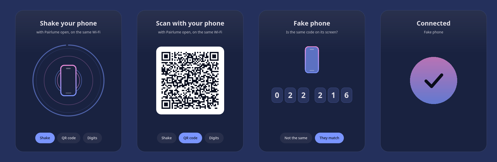
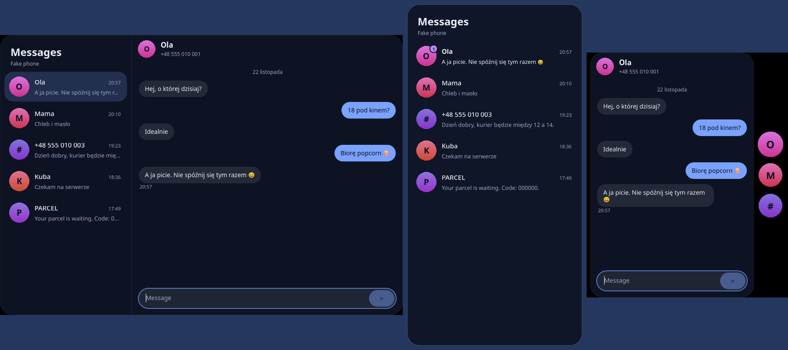
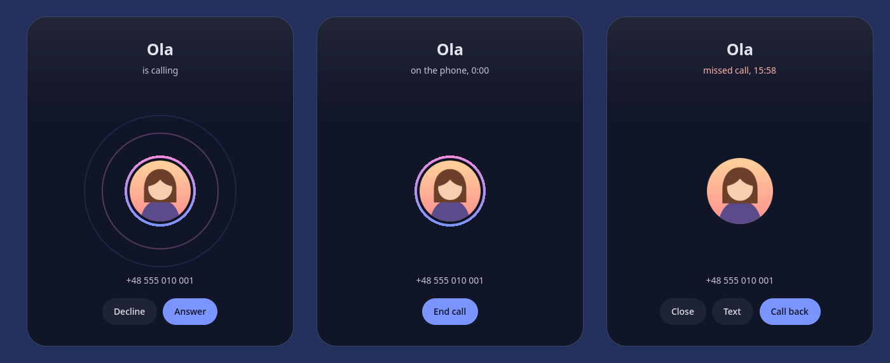

# Pairlume

Your Android phone and your Hyprland desktop as one: texts, calls, notifications, the phone's screen, and plugins.



> **Early days.** Pairing and reconnecting work between a computer and an Android phone, texts are being tried. Nothing
> here is ready for daily use.

## Where it is

| Stage | What | State |
|---|---|---|
| 0 | Project, protocol, tests | done |
| 1 | Pairing (shake, QR, digits), reconnecting, battery | works, being tried on real phones |
| 2 | Texts: window, panel, chat bubbles | works |
| 3 | Calls: who calls, answer, decline, call back (the voice stays on the phone) | works with the pretend phone, being tried on real ones |
| 4 | Notifications in three styles, colors from the wallpaper, glass, animations | planned |
| **0.1** | **first release** | |
| later | Files, clipboard, wireless screen, plugins and themes, remote control, camera | planned |

## How pairing stays safe

- The link is TLS 1.3 with a certificate on both ends. Pairing remembers the other one's fingerprint; anyone else is
  turned away, also on the same Wi-Fi.
- Shaking the phone only says "here I am". Both screens then show the same six digits, and both sides have to say yes.
- The QR code and the typed digits are used for one try.
- A paired phone may do **nothing** until you allow it, one permission at a time.
- Nothing from the phone is written to disk.

The details are in [docs/protocol.md](docs/protocol.md).

## Install

From the [releases](https://github.com/deadzone-studio/pairlume/releases): unpack `pairlume-…-linux-x86_64.zip` and run
`./install.sh` (it puts the programs in `~/.local/bin` and starts the service with your session; `./install.sh --remove`
takes it away). Install `Pairlume-….apk` on the phone. Releases are early previews until 0.1.

The phone app is signed with this key (SHA-256 of the certificate):
`50:11:B3:93:23:01:22:35:66:25:F8:4F:6B:B6:89:08:6B:BB:A9:7D:DD:7A:4B:02:9E:3C:C0:C4:D2:C3:40:A3`

## Try it

Needs a recent stable Rust.

```sh
cargo build
target/debug/pairlumed                 # the service
target/debug/pairlume pair             # in another terminal
```

The pairing window needs Qt 6 (`qt6-declarative`) and `layer-shell-qt`, and a Wayland compositor with layers. It is made
for Hyprland ([colors and glass](docs/hyprland.md)):

```sh
cargo build -p pairlume-ui
target/debug/pairlume-ui               # pairing
target/debug/pairlume-ui messages      # texts: a window
target/debug/pairlume-ui panel         # ... from the edge of the screen
target/debug/pairlume-ui bubbles       # ... as faces at the edge
target/debug/pairlume-ui calls         # waits, and shows a call when the phone rings
```





The Android app (Android 10 or newer) needs JDK 21 and the Android SDK (platform 36):

```sh
cd android && ./gradlew :app:installDebug
```

Without a phone, a pretend one does the other half:

```sh
target/debug/pairlume-fake --dir /tmp/fake shake 127.0.0.1:47321
target/debug/pairlume-fake --dir /tmp/fake run 127.0.0.1:47321
target/debug/pairlume status
```

A firewall has to let TCP port 47321 in from your network (and UDP 5353 for finding the computer).

## License

GPL-3.0-or-later. The plugin kit, when it is here, will be MIT, so a plugin can have any license.
